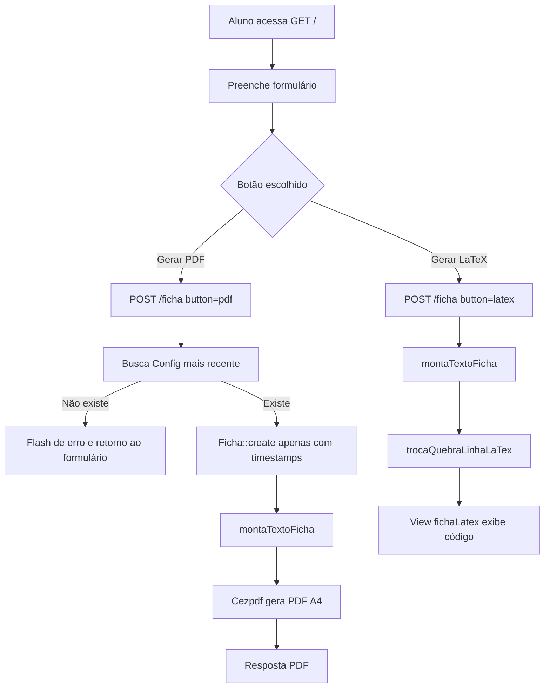

# Relatório Técnico — Sistema de Ficha Catalográfica do IME-USP

**Projeto:** `ficha-catalografica`  
**Repositório:** `git@github.com:ime-usp-br/ficha-catalografica.git`  
**Branch analisada:** `main`  
**Commit analisado:** `740cb3a` — *Update ficha.blade.php* (16/05/2024)  
**Primeiro commit:** 16/02/2022  
**Data desta análise:** 28/10/2026  
**Natureza do documento:** análise estática de código, configuração, migrations, views, histórico Git e dependências.

> **Nota metodológica:** o ambiente desta análise não possui PHP, Composer, Node.js, diretório `vendor/`, `.env` nem banco de dados configurado. Portanto, o sistema **não foi executado** durante a análise. As conclusões abaixo vêm da leitura do código-fonte, dos arquivos de configuração, do `composer.lock`, do `package-lock.json`, do histórico Git e do código-fonte das dependências externas consultadas. Comandos de instalação e execução são apresentados como procedimento recomendado, não como execução validada neste ambiente.

---

## 1. Resumo executivo

O projeto é uma aplicação web Laravel, de escopo institucional, que permite a alunos de Graduação e Pós-Graduação do Instituto de Matemática, Estatística e Ciência da Computação da Universidade de São Paulo (IME-USP) gerarem automaticamente a **ficha catalográfica** de seus trabalhos acadêmicos. O aluno preenche um formulário com dados de autoria, título, orientação, grau, programa, ano, número de páginas, ilustrações e assuntos; o sistema monta o texto da ficha em formato próximo ao usado pela biblioteca e oferece duas saídas:

1. **PDF** gerado com a biblioteca Cezpdf, em folha A4, com cabeçalho e rodapé configuráveis pela biblioteca;
2. **Trecho de código LaTeX** para ser inserido no modelo LaTeX do IME-USP.

Além da geração, há uma área administrativa restrita a usuários com permissão `admin`, acessível via autenticação Senha Única da USP, que permite editar cabeçalho e rodapé da ficha e visualizar estatísticas de fichas geradas por mês e por ano.

O sistema resolve um problema real e bem delimitado: padronizar e automatizar a emissão de um item obrigatório nos trabalhos acadêmicos, reduzindo o trabalho manual da biblioteca e dando autonomia ao aluno. A implementação, porém, é enxuta e concentra praticamente toda a regra de negócio em um único controller (`FichaController`), com poucos testes, validação de servidor não utilizada, ausência de escape adequado para HTML/LaTeX e dependências antigas. Trata-se de uma aplicação funcional e de escopo claro, mas com dívida técnica relevante para uso continuado em produção.

**Pontos fortes principais**

- Escopo bem definido e aderente à necessidade institucional.
- Fluxo simples, sem necessidade de cadastro ou login para o aluno.
- Duas saídas úteis: PDF pronto para impressão e código LaTeX integrável ao modelo da instituição.
- Cabeçalho e rodapé configuráveis pela biblioteca.
- Estatísticas de uso administrativas.
- Não armazena o conteúdo bibliográfico nem dados pessoais do aluno no banco; a tabela `fichas` guarda apenas data/hora de geração.

**Pontos críticos principais**

- `FichaRequest` existe, mas **não é usado** pelo controller; a validação efetiva é apenas HTML/JavaScript no navegador.
- Campos `nusp` e `email` são coletados, mas não são usados nem armazenados.
- Saída LaTeX é renderizada com `{!! $latex !!}` e não escapa HTML nem caracteres especiais de LaTeX, criando risco de XSS refletido e de código LaTeX inválido.
- O uso de `Cezpdf::ezStream()` dentro de `response()` é inadequado: `ezStream()` já envia cabeçalhos HTTP e faz flush do PDF, retornando `null`.
- Instituição, cidade, biblioteca, departamentos e programas estão fixos no código.
- Stack desatualizada: Laravel 8 (fim de suporte), PHP `^7.3|^8.0`, Bootstrap 5.1, jQuery 3.6, bibliotecas de PDF antigas e duplicadas.
- Apenas testes de exemplo; a lógica central de formatação não tem testes.
- Projeto não funciona “out of the box”: faltam `vendor/`, `.env`, banco migrado, configuração inicial e credenciais OAuth da USP.

---

## 2. Identificação e contexto

| Item | Informação |
|---|---|
| Nome do projeto | `ficha-catalografica` |
| Organização | IME-USP — Instituto de Matemática, Estatística e Ciência da Computação da USP |
| Repositório | GitHub `ime-usp-br/ficha-catalografica` |
| Tipo | Aplicação web monolítica Laravel |
| Finalidade | Geração de ficha catalográfica de trabalhos acadêmicos |
| Público-alvo | Alunos de Graduação e Pós-Graduação do IME-USP; biblioteca; administradores |
| Idioma da interface | Português (textos hardcoded) |
| Idioma do framework | Inglês (`config/app.php` com `locale => 'en'`) |
| Fuso horário do framework | UTC (`config/app.php`) |
| Banco padrão | MySQL (`config/database.php`) |
| Autenticação | Senha Única USP via OAuth1, com `uspdev/senhaunica-socialite` |
| Autorização | `spatie/laravel-permission`, com gate `admin` fornecido pelo pacote Senhaunica |
| PDF | Cezpdf (`rospdf/pdf-php` e `ros/ezpdf`) |
| LaTeX | Trecho gerado por concatenação de strings no controller |
| Front-end | Blade, Bootstrap 5.1.3, jQuery 3.6, SCSS compilado com Laravel Mix |
| Tamanho do repositório | Aproximadamente 4,8 MB (inclui `composer.phar` de ~2,3 MB) |

### 2.1 Contexto de uso

A ficha catalográfica é um elemento obrigatório em trabalhos acadêmicos e deve ser impressa no verso da folha de rosto. Ela contém a descrição bibliográfica padronizada do trabalho, incluindo autoria, título, orientação, natureza do trabalho, instituição, ano, paginação, ilustrações, bibliografia e assuntos. A descrição segue, no contexto do projeto, a tradição do código de catalogação AACR2 e as orientações da Biblioteca Carlos Benjamin de Lyra, do IME-USP.

Antes da automação, esse texto provavelmente era montado manualmente pela biblioteca a partir dos dados enviados pelo aluno. O sistema transforma esse processo em autoatendimento: o aluno informa os dados e recebe o PDF ou o código LaTeX imediatamente.

### 2.2 O que o sistema é

- Um **gerador de ficha catalográfica** para trabalhos do IME-USP.
- Uma ferramenta de **padronização textual** baseada em um formulário.
- Um **serviço de autoatendimento** para alunos.
- Uma **área administrativa** para a biblioteca configurar cabeçalho/rodapé e acompanhar o volume de fichas geradas.

### 2.3 O que o sistema não é

- Não é um sistema de catalogação bibliográfica completo (não usa MARC, Dublin Core, Z39.50, authority control etc.).
- Não é um repositório digital de teses e dissertações.
- Não armazena o conteúdo da ficha nem os dados pessoais do aluno no banco.
- Não envia a ficha por e-mail.
- Não gerencia alunos, matrículas ou cursos.
- Não é multi-institucional nem multiunidade: cidade, biblioteca, instituto, departamentos e programas estão fixos.
- Não oferece API pública documentada.
- Não possui fluxo de aprovação ou revisão da ficha pela biblioteca.
- Não gera o número de chamada/Cutter, embora calcule variáveis relacionadas a ele e as descarte.

---

## 3. Problema resolvido e proposta de valor

### 3.1 Problema

A ficha catalográfica precisa seguir uma formatação específica e é obrigatória. A montagem manual:

- consome tempo da equipe da biblioteca;
- está sujeita a erros de digitação, pontuação e padronização;
- depende de ida e volta entre aluno e biblioteca;
- pode atrasar a entrega do trabalho.

### 3.2 Solução proposta

O sistema oferece um formulário único, no qual o aluno informa os dados exigidos, e gera o texto formatado automaticamente. A biblioteca mantém o cabeçalho e o rodapé institucionais por meio de uma tela administrativa. O aluno escolhe entre:

- **PDF**: para impressão no verso da folha de rosto;
- **LaTeX**: para colar no modelo LaTeX do IME-USP, mantendo a ficha dentro do documento.

### 3.3 Valor entregue

- Redução do trabalho manual e do retrabalho.
- Padronização da apresentação.
- Autonomia e imediatismo para o aluno.
- Rastreamento agregado do volume de fichas geradas.
- Integração com o ecossistema USP (Senha Única, tema visual e biblioteca de autenticação).

---

## 4. Visão geral funcional

### 4.1 Perfil aluno (não autenticado)

1. Acessa `GET /`.
2. Preenche o formulário com:
   - Nº USP e e-mail (com confirmação);
   - nome e último sobrenome;
   - título e subtítulo;
   - grau acadêmico;
   - departamento (Graduação) ou programa de pós-graduação;
   - versão do trabalho (original/corrigida), quando aplicável;
   - nome e sobrenome do orientador, com indicação de orientadora;
   - nome e sobrenome do coorientador, com indicação de coorientadora (opcional);
   - ano, número de páginas e presença de ilustrações;
   - de 1 a 5 assuntos.
3. Escolhe **Gerar PDF** ou **Gerar código LaTeX**.
4. O formulário é enviado por `POST /ficha` em uma nova aba (`target="_blank"`).
5. O sistema responde com o PDF (aberto no navegador) ou com uma página contendo o trecho LaTeX.

### 4.2 Perfil administrador/biblioteca

1. Acessa o sistema e faz login pela Senha Única USP (`/login`, rota fornecida pelo pacote `senhaunica-socialite`).
2. Usuários listados em `SENHAUNICA_ADMINS` recebem a permissão `admin`.
3. Acessa `/configs` para ver:
   - cabeçalho e rodapé atuais;
   - tabela de fichas geradas por mês/ano;
   - total de fichas.
4. Acessa `/configs/edit` para editar cabeçalho e rodapé.
5. Salva via `POST /configs/save`; o sistema atualiza o registro mais recente de `configs`.

### 4.3 Fluxo principal



---

## 5. Arquitetura e tecnologias

### 5.1 Padrão arquitetural

A aplicação segue o padrão MVC do Laravel, mas de forma concentrada:

- **Model:** `App\Models\Ficha`, `App\Models\Config` e `App\Models\User`.
- **View:** arquivos Blade em `resources/views`.
- **Controller:** `FichaController` e `ConfigController`.
- **Rotas:** `routes/web.php`.
- **Persistência:** Eloquent + migrations.
- **Autenticação/autorização:** pacotes externos.
- **Geração de PDF:** biblioteca externa Cezpdf.
- **Build de assets:** Laravel Mix/Webpack.

Não há camada de serviço, repositório, DTO, action ou job. A regra de formatação da ficha está inteiramente dentro de `FichaController::montaTextoFicha()` (`app/Http/Controllers/FichaController.php:14-93`). Isso simplifica o entendimento, mas dificulta testes, reutilização e evolução.

### 5.2 Stack de back-end

| Tecnologia | Versão/restrição | Papel |
|---|---|---|
| PHP | `^7.3 \| ^8.0` | Linguagem de execução |
| Laravel Framework | `v8.83.1` (lock) | Framework web |
| Laravel Sanctum | `^2.11` | Tokens de API (não usado na aplicação) |
| Laravel Tinker | `^2.5` | REPL |
| `fruitcake/laravel-cors` | `^2.0` | CORS |
| Guzzle | `^7.0.1` | Cliente HTTP |
| `barryvdh/laravel-dompdf` | `v1.0.0` | PDF via HTML (declarado, mas não usado) |
| `ros/ezpdf` | `0.12.1` | Biblioteca Cezpdf (uma das origens da classe) |
| `rospdf/pdf-php` | `0.12.63` | Cpdf/Cezpdf (usada na prática) |
| `uspdev/laravel-usp-theme` | `2.4.3` | Tema/layout institucional |
| `uspdev/senhaunica-socialite` | `4.3.1` | Login OAuth1 Senha Única USP, gates e rotas de usuários |
| `spatie/laravel-permission` | `4.4.3` (transitiva) | Permissões e papéis |
| `laravel/socialite` | `v5.5.1` (transitiva) | OAuth |
| `doctrine/dbal` | `3.3.3` (transitiva) | Alterações de colunas em migrations |

### 5.3 Stack de front-end

| Tecnologia | Versão | Papel |
|---|---|---|
| Blade | Laravel 8 | Templates server-side |
| Bootstrap | 5.1.3 | Estilos e componentes |
| jQuery | 3.6 | Scripts legados |
| SCSS/Sass | 1.49.9 | Fonte dos estilos |
| Laravel Mix | 6.0.43 | Build de assets |
| Axios/Lodash | `^0.21` / `^4.17` | Dependências de desenvolvimento não usadas nas views |

O build (`webpack.mix.js`) compila:

- `resources/views/scss/style.scss` → `public/site/style.css`;
- `node_modules/jquery/dist/jquery.js` → `public/site/jquery.js`;
- `node_modules/bootstrap/dist/js/bootstrap.bundle.js` → `public/site/bootstrap.js`.

Os arquivos compilados estão versionados em `public/site/`. O caminho do SCSS dentro de `resources/views/scss/` é incomum (o padrão seria `resources/scss/` ou `resources/css/`), mas funciona.

### 5.4 Estrutura de diretórios relevante

```text
ficha-catalografica/
├── app/
│   ├── Http/
│   │   ├── Controllers/
│   │   │   ├── FichaController.php      # Núcleo da geração da ficha
│   │   │   └── ConfigController.php     # Configuração e estatísticas
│   │   ├── Middleware/                  # Middlewares padrão do Laravel
│   │   └── Requests/
│   │       └── FichaRequest.php         # Validação declarada, mas não utilizada
│   ├── Models/
│   │   ├── User.php                     # Usuário + Senha Única + Spatie
│   │   ├── Ficha.php                    # Apenas id/timestamps
│   │   └── Config.php                   # Cabeçalho/rodapé
│   ├── Providers/                       # Providers padrão
│   └── Console/Kernel.php
├── bootstrap/
│   └── app.php
├── config/
│   ├── app.php
│   ├── auth.php
│   ├── database.php
│   ├── dompdf.php                       # Config do Dompdf (não usado)
│   ├── laravel-usp-theme.php            # Tema, menus e título
│   ├── session.php
│   └── ...                              # Demais configurações padrão
├── database/
│   ├── migrations/                      # Tabelas do Laravel + permissões + fichas/configs
│   ├── factories/UserFactory.php
│   └── seeders/DatabaseSeeder.php       # Vazio
├── public/
│   ├── index.php                        # Entry point
│   ├── .htaccess
│   ├── site/                            # CSS/JS compilados versionados
│   └── vendor/                          # Assets do tema (gerado, ignorado pelo Git)
├── resources/
│   ├── views/
│   │   ├── main.blade.php               # Layout base da aplicação
│   │   ├── ficha/
│   │   │   ├── ficha.blade.php          # Formulário
│   │   │   └── fichaLatex.blade.php     # Exibição do código LaTeX
│   │   ├── config/
│   │   │   ├── configs.blade.php        # Estatísticas e link de edição
│   │   │   └── edit.blade.php           # Edição de cabeçalho/rodapé
│   │   ├── scss/style.scss              # Fonte dos estilos
│   │   └── welcome.blade.php            # Resíduo do Laravel, não usado
│   └── js/, css/                        # Defaults do Laravel, não usados
├── routes/
│   ├── web.php                          # Rotas da aplicação
│   ├── api.php                          # Rota default /api/user (não usada)
│   ├── channels.php
│   └── console.php
├── storage/                             # Logs, sessões, cache, views compiladas
├── tests/
│   ├── Feature/ExampleTest.php          # GET / == 200
│   └── Unit/ExampleTest.php             # assertTrue(true)
├── composer.json / composer.lock
├── composer.phar                        # Composer versionado no repositório
├── package.json / package-lock.json
├── webpack.mix.js
├── phpunit.xml
├── .env.example
└── README.md                            # Duas linhas
```

---

## 6. Modelo de dados

### 6.1 Tabelas principais

#### `users`

Criada pelo migration padrão do Laravel e alterada por `2022_03_03_145704_update_senhaunica_users_table.php`:

| Coluna | Tipo | Observação |
|---|---|---|
| `id` | bigint unsigned | PK |
| `name` | string | Nome do usuário |
| `email` | string unique | E-mail |
| `email_verified_at` | timestamp nullable | Não usado pela aplicação |
| `password` | string nullable | Tornado opcional para login via Senha Única |
| `remember_token` | string nullable | Padrão |
| `created_at`, `updated_at` | timestamps | Padrão |
| `codpes` | integer | Número USP; usado pelo pacote Senhaunica; nullable em SQLite |

#### `configs`

| Coluna | Tipo | Observação |
|---|---|---|
| `id` | bigint unsigned | PK |
| `created_at`, `updated_at` | timestamps | Usado para escolher o registro mais recente |
| `cabecalho` | text nullable | Cabeçalho institucional do PDF |
| `rodape` | text nullable | Rodapé institucional do PDF |

Houve uma coluna `num_fichas`, criada em `2022_03_16_111110_add_num_fichas_column_to_configs_table.php` e removida em `2022_05_04_131620_drop_column_num_fichas_in_configs_table.php`. Hoje a contagem é feita pela tabela `fichas`.

#### `fichas`

| Coluna | Tipo | Observação |
|---|---|---|
| `id` | bigint unsigned | PK |
| `created_at`, `updated_at` | timestamps | Única informação registrada |

A tabela **não guarda** nome, NUSP, e-mail, título, orientador ou qualquer conteúdo da ficha. Ela serve apenas para contar quantas fichas em PDF foram geradas e quando.

#### Tabelas de permissão

Criadas por `2022_03_03_145704_create_permission_tables.php`:

- `permissions`
- `roles`
- `model_has_permissions`
- `model_has_roles`
- `role_has_permissions`

Essas tabelas pertencem ao ecossistema Spatie Laravel Permission/Benhaunica e não têm relacionamento direto com `fichas` ou `configs`.

#### Tabelas padrão do Laravel

- `password_resets`
- `failed_jobs`
- `personal_access_tokens` (Sanctum)
- `migrations` (criada automaticamente)

### 6.2 Relacionamentos

Não há chaves estrangeiras entre as tabelas da aplicação. O modelo é deliberadamente simples:

```text
users 1---N model_has_roles N---1 roles
roles N---N permissions (role_has_permissions)
users N---N permissions (model_has_permissions)

configs   (registro independente; usa-se o mais recente)
fichas    (registro independente; apenas contagem)
```

### 6.3 Implicações do modelo

- **Privacidade:** como a ficha não é persistida, o banco não contém os dados bibliográficos nem pessoais do aluno. Isso reduz risco de vazamento e simplifica a LGPD, embora os logs do servidor web possam registrar IP e metadados da requisição.
- **Auditoria:** não é possível saber quem gerou qual ficha, nem reprocessar uma ficha antiga.
- **Estatística:** a contagem mede gerações de PDF, não pessoas únicas. Um mesmo aluno pode gerar várias fichas e inflar o total.
- **Configuração:** só existe um conjunto “ativo” de cabeçalho/rodapé; não há histórico de versões.

---

## 7. Rotas e endpoints

### 7.1 Rotas definidas pela aplicação

`routes/web.php` (linhas 18-26):

| Método | Caminho | Controller/ação | Autenticação | Função |
|---|---|---|---|---|
| GET | `/` | Closure → `view('ficha.ficha')` | Pública | Exibe o formulário |
| POST | `/ficha` | `FichaController@montarFicha` | Pública | Gera PDF ou LaTeX |
| GET | `/configs` | `ConfigController@mostrarConfigs` | `authorize('admin')` | Painel de configuração e estatísticas |
| GET | `/configs/edit` | `ConfigController@edit` | `authorize('admin')` | Formulário de edição |
| POST | `/configs/save` | `ConfigController@save` | `authorize('admin')` | Salva cabeçalho/rodapé |

As rotas da aplicação não possuem nomes (`name()`), e os formulários usam caminhos absolutos (`/ficha`, `/configs/edit`, `/configs/save`), o que dificulta deploy em subdiretório.

### 7.2 Rotas fornecidas pelo pacote Senhaunica

O pacote `uspdev/senhaunica-socialite` registra automaticamente, por padrão (`config('senhaunica.routes') === true`):

| Método | Caminho | Função |
|---|---|---|
| GET | `/login` | Inicia o fluxo OAuth1 com a Senha Única USP |
| GET | `/callback` | Callback OAuth |
| POST | `/logout` | Encerra a sessão |
| GET/POST | `/loginas` | Assume identidade de outro usuário (recurso administrativo) |
| GET | `/undologinas` | Desfaz o “login as” |
| resource | `/users` | Gerenciamento de usuários/permissões (admin) |

Essas rotas **não aparecem** em `routes/web.php`; são carregadas pelo service provider do pacote. Isso é relevante para quem for manter o sistema: a sensação de que “não existe rota de login” é apenas um efeito da auto-descoberta de pacotes.

### 7.3 Rota de API

`routes/api.php` contém apenas a rota padrão:

```php
Route::middleware('auth:sanctum')->get('/user', ...);
```

Ela não é usada pela aplicação. O Sanctum está instalado, mas não há emissão de tokens nem consumo de API.

---

## 8. Núcleo da geração da ficha

### 8.1 Formulário

O formulário está em `resources/views/ficha/ficha.blade.php` (308 linhas). Ele é dividido visualmente em blocos:

- **Dados do solicitante:** Nº USP, e-mail, confirmação de e-mail, nome e último sobrenome.
- **Informações do trabalho:** título, subtítulo, grau acadêmico, departamento ou programa, versão, orientador/coorientador, ano, páginas, ilustrações e assuntos.
- **Botões:** “Gerar PDF” e “Gerar código LaTeX”, ambos com `name="button"` e valores `pdf` e `latex` (linhas 296-297).

O formulário:

- usa `@csrf` (linha 5), portanto está protegido contra CSRF;
- usa `target="_blank"` (linha 4), abrindo o resultado em nova aba;
- usa validação HTML5 (`required`) e JavaScript inline;
- possui um script `clickCheck()` que mostra/esconde departamento, programa e versão conforme o grau;
- possui um script `confirmEmail()` que apenas exibe um `alert` se os e-mails forem diferentes, sem impedir o envio.

### 8.2 Validação: o ponto mais importante

Existe uma classe `App\Http\Requests\FichaRequest` com regras de validação bem detalhadas (`app/Http/Requests/FichaRequest.php:24-51`), incluindo:

- `nusp` obrigatório;
- `email` obrigatório, formato de e-mail e `confirmed`;
- nome, sobrenome, título e grau obrigatórios;
- departamento obrigatório para Graduação;
- área de concentração e versão obrigatórias para determinados graus;
- orientador obrigatório;
- coorientador obrigatório;
- ano e número de páginas numéricos;
- ilustrações obrigatórias;
- assunto 1 obrigatório e assuntos 2–5 opcionais.

**Contudo, o controller não usa essa classe.** A assinatura é:

```php
public function montarFicha(Request $request)
```

em `app/Http/Controllers/FichaController.php:101`, e não há `use App\Http\Requests\FichaRequest;` nem injeção de `FichaRequest`. Portanto:

- nenhuma regra do `FichaRequest` é aplicada;
- a validação real é apenas a do navegador;
- requisições diretas via `curl`/Postman podem enviar dados vazios, enormes ou malformados;
- o servidor aceita e-mails inválidos, e-mails não confirmados, anos não numéricos, páginas não numéricas, assuntos vazios etc.;
- o próprio `FichaRequest` tem inconsistências que precisariam ser corrigidas antes de ser ativado:
  - os checkboxes `sou_orientadora`/`sou_coorientadora` enviam o valor textual `"True"`, mas a regra `boolean` do Laravel 8 aceita apenas `true`, `false`, `0`, `1`, `'0'`, `'1'`; logo, se a validação fosse ativada sem ajuste, os checkboxes marcados falhariam;
  - `coorientador_nome` e `coorientador_ultimonome` são `required` no `FichaRequest`, mas o formulário os trata como opcionais (o `required` HTML foi removido em commits anteriores);
  - `email` usa `confirmed`, mas a confirmação só é verificada no cliente e o controller ignora o resultado.

### 8.3 Montagem do texto (`montaTextoFicha`)

A função `montaTextoFicha($request)` (`app/Http/Controllers/FichaController.php:14-93`) recebe o request e devolve uma string com a ficha. As etapas são:

1. **Gênero do orientador/coorientador**
   - `$orientadora = $request['sou_orientadora'] ? 'a' : '';`
   - `$coorientadora = $request['sou_coorientadora'] ? 'a' : '';`
   - O sufixo é usado em “orientador(a)” e “coorientador(a)”.

2. **Cálculo de código Cutter (não utilizado)**
   - `$codigo1` recebe a primeira letra do último sobrenome;
   - `$codigo2` recebe a primeira letra da primeira palavra do título ou, se ela for uma *stopword* (artigo/preposição), a primeira letra da segunda palavra;
   - há uma lista de stopwords em português (linha 25);
   - as variáveis são calculadas, mas **não são usadas**: a linha que montaria o código está comentada (linhas 39-40). O campo `cod` do PDF é enviado vazio.
   - A lógica ainda é executada e pode causar erro em títulos formados por uma única stopword, pois acessa `$vetitulo[1]` sem verificar se existe (linha 28). Em Laravel, um *warning* de índice indefinido pode ser convertido em `ErrorException` e gerar HTTP 500, dependendo da configuração de erros.

3. **Título e subtítulo**
   - Se `subtitulo_trabalho` não estiver vazio: `Título: Subtítulo`;
   - caso contrário: apenas o título.

4. **Orientação**
   - Monta `; orientador(a), Nome Sobrenome` e `; coorientador(a), Nome Sobrenome`;
   - inclui o trecho somente se nome **e** sobrenome estiverem preenchidos;
   - se o coorientador for opcional, ele é omitido quando incompleto.

5. **Ilustrações**
   - Se `ilustracoes === 'Sim'`, acrescenta `: il.`;
   - caso contrário, não acrescenta nada.

6. **Cidade**
   - `$request['cidade'] = "São Paulo";` (linha 58), sobrescrevendo qualquer valor. A cidade é fixa.

7. **Texto principal**
   - Primeira linha: `Sobrenome, Nome`;
   - Segunda linha: `Título: Subtítulo / Nome Sobrenome; orientador(a), ... . - São Paulo, Ano.`;
   - Terceira linha: `N p.: il.`;
   - Quarto bloco: grau acadêmico + ` - ` + departamento/programa + `/ Instituto de Matemática, Estatística e Ciência da Computação / Universidade de São Paulo.`;
   - `Bibliografia`;
   - versão do trabalho;
   - assuntos numerados;
   - entradas adicionais de orientador e título.

8. **Vínculo institucional**
   - Para Graduação: usa `departamento` (ex.: `Departamento de Ciência da Computação`);
   - Para Pós-Graduação: usa `area_concentracao` (ex.: `Programa de Pós-Graduação em Matemática`);
   - Para `Dissertação (Mestrado Profissional)`: força o texto `Programa de Pós-Graduação Mestrado Profissional em Ensino de Matemática`, ignorando a seleção do formulário (linha 64);
   - Em todos os casos, acrescenta `/ Instituto de Matemática, Estatística e Ciência da Computação / Universidade de São Paulo.`.

9. **Assuntos**
   - Até 5 assuntos, numerados `1.` a `5.`;
   - o assunto 1 é obrigatório no HTML, mas não há validação de servidor;
   - não há controle de autoridade nem consulta ao Vocabulário Controlado da USP; o formulário apenas oferece um link externo.

10. **Entradas adicionais**
    - Se houver orientador, acrescenta `I. Sobrenome, Nome. II. Título.`;
    - Se **não** houver orientador, esse trecho é omitido por completo, inclusive o `II. Título.`;
    - O coorientador aparece no corpo da ficha, mas não recebe entrada adicional própria.

### 8.4 Exemplo de saída

Para os dados:

- Nome: `João Carlos da`
- Último sobrenome: `Silva Neto`
- Título: `Análise de séries temporais`
- Subtítulo: `um estudo de caso`
- Grau: `Dissertação (Mestrado)`
- Área: `Programa de Pós-Graduação em Matemática`
- Orientadora: `Maria Souza`
- Co orientador: não informado
- Ano: `2024`
- Páginas: `120`
- Ilustrações: `Sim`
- Versão: `Versão original`
- Assuntos: `Estatística`, `Séries temporais`

O texto gerado seria aproximadamente:

```text
Silva Neto, João Carlos da
   Análise de séries temporais: um estudo de caso / João Carlos da Silva Neto; orientadora, Maria Souza. - São Paulo, 2024.
   120 p.: il.

   Dissertação (Mestrado) - Programa de Pós-Graduação em Matemática / Instituto de Matemática, Estatística e Ciência da Computação / Universidade de São Paulo.
   Bibliografia
   Versão original

   1. Estatística. 2. Séries temporais. I. Souza, Maria. II. Título.
```

Observações sobre o exemplo:

- O sobrenome **não é convertido automaticamente para maiúsculas**; sai exatamente como digitado.
- Não há normalização de espaços, partículas ou pontuação.
- O texto é montado por concatenação simples; espaços e pontuação dependem da combinação exata dos campos.
- O campo `nusp` e o `email` não aparecem na ficha.

### 8.5 Geração do PDF

No branch `else` de `montarFicha` (`app/Http/Controllers/FichaController.php:136-176`):

1. Busca a configuração mais recente:
   ```php
   $config = Config::orderByDesc('created_at')->first();
   ```
2. Se não existir configuração, grava um flash `alert-danger` (“Não existem configurações salvas.”) e redireciona de volta.
3. Cria um registro em `fichas`:
   ```php
   Ficha::create();
   ```
   Apenas `id` e timestamps são gravados.
4. Monta o texto com `montaTextoFicha($request)`.
5. Instancia `Cezpdf` em A4 retrato, fundo branco:
   ```php
   $pdf = new Cezpdf('a4','portrait','color',[255,255,255]);
   ```
6. Seleciona `Times-Roman` e escreve o cabeçalho configurado, centralizado, em 10 pt.
7. Seleciona `Courier` e desenha uma linha de underscores.
8. Usa `ezTable` para o texto da ficha, com fonte 9 pt, sem cabeçalhos, sem linhas, largura 345 e coluna `cod` com largura 0.
9. Desenha outra linha de underscores.
10. Seleciona `Courier` e escreve o rodapé configurado, centralizado, em 9 pt.
11. Retorna:
    ```php
    return response($pdf->ezStream(), 200)
        ->header('Content-Type', 'application/pdf');
    ```

**Ponto técnico relevante:** na versão usada de `rospdf/pdf-php`, `Cezpdf::ezStream()` **não retorna o PDF como string**. Ele chama `Cpdf::stream()`, que:

- gera o PDF;
- inicia um buffer, ecoa o PDF;
- envia cabeçalhos `Content-Type`, `Content-Length`, `Content-Disposition`;
- faz `ob_end_flush()`;
- retorna `null`.

Portanto, `response($pdf->ezStream(), 200)` está tecnicamente incorreto: o PDF já foi emitido diretamente, e a resposta Laravel recebe `null`. Dependendo do buffering do PHP/FPM e do servidor, isso pode funcionar por acidente, mas também pode causar:

- cabeçalhos duplicados ou “headers already sent”;
- `Content-Length` inconsistente;
- corpo vazio na resposta Laravel;
- dificuldade de testar o endpoint com `assertDownload`/`assertHeader`.

O uso correto seria `$pdf->ezOutput()` (retorna string) ou fazer o streaming diretamente e encerrar a requisição de forma controlada.

**Outros pontos do PDF:**

- O nome do arquivo não é definido; o navegador usa o nome padrão da URL.
- Não há tratamento de exceção em torno da geração; erros de fonte, conteúdo ou memória viram erro 500.
- O cabeçalho/rodapé é passado por `str_replace('\n', PHP_EOL, ...)`. Como a string `'\n'` está entre aspas simples, ela representa **barra invertida + n**, não uma quebra de linha real. A intenção provavelmente era converter `\n` literais digitados no textarea; quebras de linha reais enviadas pelo navegador permanecem como estão.
- Não há limite de tamanho para o texto; títulos muito longos podem estourar o layout da tabela.
- As fontes usadas são as “Base 14” do PDF (Times-Roman, Courier), sem incorporação de fontes. Isso favorece compatibilidade, mas pode limitar acentuação/glifos dependendo da codificação.
- O Dompdf está instalado e configurado (`config/dompdf.php`, provider e alias `PDF`), mas **não é usado** na geração. Isso é dependência morta e aumenta a superfície de ataque/manutenção.

### 8.6 Geração do LaTeX

No branch `if ($request['button'] == "latex")` (`app/Http/Controllers/FichaController.php:103-135`):

- O sistema monta um trecho LaTeX com comentários e comandos;
- o trecho depende das packages `calc`, `setspace` e `ragged2e`, segundo o próprio comentário;
- usa `\begingroup\centering\singlespacing\small`, `\hyphenrules{nohyphenation}`, `\hbadness=10000`, `\RaggedRight...`, `\ttfamily`, `\begin{minipage}[t]{125mm}`, `\hrule`, entre outros;
- inclui textos fixos da biblioteca e das bibliotecárias responsáveis;
- insere o texto da ficha por meio de `trocaQuebraLinhaLaTex($texto)`;
- retorna a view `ficha.fichaLatex`, que exibe o conteúdo com `{!! $latex !!}`.

**Características e problemas:**

- O branch LaTeX **não consulta `Config`**; portanto, cabeçalho e rodapé configurados pela biblioteca **não são usados** nessa saída. O texto institucional é fixo no controller.
- O branch LaTeX **não cria registro em `fichas`**; logo, as estatísticas contam apenas PDFs.
- O resultado é exibido em HTML, com tags `<br>` no meio do código LaTeX, para dar quebra de linha visual. Não há botão de download de um arquivo `.tex`.
- A view usa `{!! $latex !!}`, ou seja, **não escapa** a saída. Como o texto inclui dados digitados pelo usuário (título, nomes, assuntos etc.), é possível injetar HTML/JavaScript na página de resultado. O risco é atenuado pelo CSRF e pelo fato de a resposta não ser persistida, mas é uma falha de escaping que deve ser corrigida.
- Não há escape de caracteres especiais de LaTeX (`&`, `%`, `$`, `#`, `_`, `{`, `}`, `~`, `^`, `\`). Um título como `50% de acurácia` ou `C++ & Python` gera código LaTeX inválido; um título com `\` pode introduzir comandos indesejados. O commit `d0f0763` menciona “Arruma bugs envolvendo caracteres de escape”, mas o código atual não contém uma rotina de escape.
- O texto é montado com `str_replace` de quebras de linha para `<br>` e `\vspace{1\baselineskip}<br>`, o que mistura HTML e LaTeX; funciona para exibição, mas não gera um arquivo LaTeX limpo.
- Não há validação de compilação nem verificação de que o trecho produzido é aceito pelo modelo do IME.

### 8.7 Configuração e estatísticas

`ConfigController` (`app/Http/Controllers/ConfigController.php`):

- `mostrarConfigs()`:
  - autoriza `admin`;
  - busca a configuração mais recente;
  - se não existir, cria uma instância vazia apenas para a view;
  - carrega **todas** as fichas (`Ficha::select('*')->orderBy('created_at','asc')->get()`);
  - percorre uma a uma, agrupando por ano e mês;
  - monta `$num_fichas`, `$totalFichas`, `$anos` e a lista fixa de meses;
  - renderiza `config.configs`.
- `edit()`:
  - autoriza `admin`;
  - carrega a configuração mais recente (ou uma nova);
  - renderiza o formulário de edição.
- `save()`:
  - autoriza `admin`;
  - lê `cabecalho` e `rodape` diretamente do request;
  - não valida nem limita tamanho;
  - se não existe configuração, cria; se existe, atualiza a mais recente;
  - grava flash `alert-info` e redireciona para `/configs`.

**Estatísticas:**

- A tabela mostra meses nas linhas e anos nas colunas;
- mostra o total por ano e o total geral;
- a última coluna é deixada vazia (por decisão de interface; há CSS para colorir a última célula);
- como `Ficha::create()` só ocorre no branch PDF, **gerações de LaTeX não entram na contagem**;
- como não há identificador de aluno, **não é possível contar pessoas únicas**;
- a consulta carrega todos os registros em memória; para volumes grandes, seria melhor usar agregação SQL (`GROUP BY YEAR(created_at), MONTH(created_at)`);
- o fuso do framework é UTC (`config/app.php:70`), então a contagem por mês usa UTC. Em São Paulo (UTC-3), uma ficha gerada no último dia do mês às 22h pode ser contabilizada no mês seguinte. Para estatísticas institucionais, o ideal é usar `America/Sao_Paulo` ou converter explicitamente;
- não há filtros, exportação CSV, gráficos, exclusão ou reset.

---

## 9. Autenticação e autorização

### 9.1 Senha Única USP

A autenticação é delegada ao pacote `uspdev/senhaunica-socialite`:

- provider OAuth1 da Senha Única;
- rotas `/login`, `/callback`, `POST /logout`, `/loginas`, `/undologinas`, `/users`;
- trait `HasSenhaunica` no model `User`;
- trait `HasRoles` do Spatie no model `User`;
- configuração por variáveis de ambiente (`SENHAUNICA_KEY`, `SENHAUNICA_SECRET`, `SENHAUNICA_CALLBACK_ID`, `SENHAUNICA_ADMINS`, etc.);
- o callback precisa estar cadastrado no sistema da USP com a URL `APP_URL/callback`.

### 9.2 Permissões

O pacote registra o gate `admin` (e outros) via Spatie. Usuários listados em `SENHAUNICA_ADMINS` recebem a permissão `admin`; o gate `admin` é usado em:

- `ConfigController::mostrarConfigs()` (`:13`);
- `ConfigController::edit()` (`:49`);
- `ConfigController::save()` (`:59`);
- menu de configurações no tema (`config/laravel-usp-theme.php:74-81`).

O `AuthServiceProvider` da aplicação (`app/Providers/AuthServiceProvider.php`) **não define** o gate `admin`; ele vem do pacote. Se o pacote for removido ou a opção `senhaunica.permission` for desabilitada, as rotas de configuração deixam de funcionar.

### 9.3 Pontos de atenção

- As rotas `/configs*` **não usam o middleware `auth`**; a proteção é feita apenas por `$this->authorize('admin')`. Para um visitante não autenticado, o comportamento tende a ser **403**, não um redirecionamento para `/login`.
- Se `SENHAUNICA_ADMINS` não estiver configurado, ninguém terá `admin`; a área de configuração fica inacessível, e sem configuração inicial o PDF não é gerado.
- O gerenciamento de usuários (`/users`) é fornecido pelo pacote e também é restrito a admin.
- O pacote permite “loginas” (assumir identidade), recurso poderoso que deve ser usado com cautela em produção.
- O tema exibe o ícone de engrenagem apenas para `admin`; a rota ainda pode ser acessada diretamente, mas será barrada pelo gate.
- Não há autenticação para o aluno; isso é intencional e adequado ao caso de uso, mas significa que o endpoint de geração é público e pode ser abusado (ver seção de riscos).

---

## 10. Instalação e execução

### 10.1 Pré-requisitos

- PHP compatível com Laravel 8: `^7.3|^8.0` (na prática, recomenda-se PHP 8.0/8.1 para uma instalação nova, mas a stack antiga pode exigir ajustes em versões mais recentes).
- Extensões PHP usuais do Laravel: `mbstring`, `openssl`, `pdo`, `pdo_mysql`, `tokenizer`, `xml`, `ctype`, `json`, `bcmath` (conforme necessidade), `curl` (para OAuth/Senha Única), `fileinfo`.
- MySQL 5.7+ ou MariaDB compatível.
- Composer 2 (o repositório inclui `composer.phar`).
- Node.js/npm apenas se for necessário reconstruir assets; os assets compilados já estão em `public/site/`.
- Servidor web com DocumentRoot em `public/` (Apache com `.htaccess` ou Nginx com `try_files`).
- Credenciais OAuth da Senha Única USP (`SENHAUNICA_KEY`, `SENHAUNICA_SECRET`, `SENHAUNICA_CALLBACK_ID`).
- Acesso à internet para o fluxo OAuth e para o servidor da USP.

### 10.2 Passo a passo sugerido

```bash
# 1. Clonar o repositório
git clone git@github.com:ime-usp-br/ficha-catalografica.git
cd ficha-catalografica

# 2. Instalar dependências PHP
composer install
# Alternativa, usando o composer.phar versionado:
# php composer.phar install

# 3. Criar o arquivo de ambiente
cp .env.example .env

# 4. Gerar a chave da aplicação
php artisan key:generate

# 5. Editar .env com banco, URL e Senha Única
#    DB_CONNECTION=mysql
#    DB_HOST=127.0.0.1
#    DB_PORT=3306
#    DB_DATABASE=ficha_catalografica
#    DB_USERNAME=...
#    DB_PASSWORD=...
#    APP_URL=https://seu-dominio
#    SENHAUNICA_KEY=...
#    SENHAUNICA_SECRET=...
#    SENHAUNICA_CALLBACK_ID=...
#    SENHAUNICA_ADMINS=1234567,7654321

# 6. Criar o banco e rodar as migrations
php artisan migrate

# 7. Subir o servidor local
php artisan serve
```

Depois:

1. Acesse `http://127.0.0.1:8000`.
2. Faça login em `/login` com um usuário cujo `codpes` esteja em `SENHAUNICA_ADMINS`.
3. Acesse `/configs/edit` e salve o cabeçalho e o rodapé iniciais.
4. Sem esse passo, a geração de PDF responde com “Não existem configurações salvas.” e volta ao formulário.

### 10.3 Alternativa para criar a configuração inicial sem interface

Se for necessário preparar o banco sem depender do login:

```bash
php artisan tinker
```

```php
\App\Models\Config::create([
    'cabecalho' => "Biblioteca Carlos Benjamin de Lyra\nInstituto de Matemática, Estatística e Ciência da Computação\nUniversidade de São Paulo",
    'rodape' => "Ficha catalográfica elaborada com dados inseridos pelo(a) autor(a)",
]);
```

Isso é apenas uma sugestão operacional; o sistema não possui seed para isso.

### 10.4 Build de assets

Os assets compilados estão versionados em `public/site/`. Se for alterar SCSS/JS:

```bash
npm install
npm run prod
# ou, durante o desenvolvimento:
npm run dev
```

O `composer install` executa um script pós-autoload que publica os assets do tema USP em `public/vendor` (diretório ignorado pelo Git). Se isso não ocorrer, rode manualmente:

```bash
php artisan vendor:publish --provider="Uspdev\UspTheme\ServiceProvider" --tag=assets --force
```

### 10.5 Permissões de diretórios

O servidor web precisa de escrita em:

- `storage/`
- `storage/framework/`
- `storage/framework/sessions/`
- `storage/framework/views/`
- `storage/framework/cache/`
- `storage/logs/`
- `bootstrap/cache/`

O projeto não inclui `storage/fonts/`, mas o `config/dompdf.php` aponta para ele. Como o Dompdf não é usado, isso não afeta a geração atual; se for ativado, o diretório precisará existir e ser gravável.

### 10.6 Produção

Recomendações mínimas:

- `APP_ENV=production`
- `APP_DEBUG=false`
- `APP_URL` com HTTPS
- banco e credenciais fora do repositório
- `php artisan config:cache`
- `php artisan route:cache`
- `php artisan view:cache`
- backup periódico do banco (especialmente `configs`; `fichas` é apenas estatística)
- servidor web apontando para `public/`
- proteção do `/loginas` e do `/users` conforme política institucional
- monitoramento de erros e logs
- rotação de logs
- callback OAuth cadastrado na USP com a URL correta

### 10.7 Verificação funcional sugerida

1. `GET /` retorna 200 e mostra o formulário.
2. `POST /ficha` com `button=pdf` e dados válidos retorna `Content-Type: application/pdf` e um PDF abrível.
3. Sem configuração salva, o PDF não é gerado e o usuário recebe o aviso.
4. `POST /ficha` com `button=latex` retorna a página com o código.
5. `/configs` sem login retorna 403.
6. `/configs` com admin mostra a tabela.
7. Salvar cabeçalho/rodapé e gerar novo PDF reflete os textos.
8. Gerar PDF duas vezes incrementa o total em 2; gerar LaTeX não incrementa.
9. Testar títulos com acentos, `%`, `&`, `_`, `#` e `<script>` para verificar escaping (atualmente deve falhar).
10. Testar título composto por uma única stopword (ex.: `O`) para verificar o erro de índice.

---

## 11. Uso do sistema

### 11.1 Fluxo do aluno

1. Acesse a página inicial.
2. Preencha os dados exatamente como devem aparecer na ficha:
   - use o campo “Prenome, primeiros sobrenomes, partículas” para a parte inicial do nome;
   - use “Último sobrenome e acréscimos de agnomes” para o sobrenome final (ex.: `Silva Neto`);
   - informe título e subtítulo separadamente;
   - escolha o grau; o formulário mostra os campos correspondentes;
   - informe o orientador e, se houver, o coorientador;
   - marque “Orientadora?”/“Coorientadora?” quando aplicável;
   - informe ano, número de páginas e ilustrações;
   - informe de 1 a 5 assuntos, preferencialmente consultando o Vocabulário Controlado da USP.
3. Clique em **Gerar PDF** ou **Gerar código LaTeX**.
4. No PDF, verifique cabeçalho, rodapé e texto antes de imprimir no verso da folha de rosto.
5. No LaTeX, copie o trecho para o modelo do IME-USP e compile o documento; ajuste manualmente se necessário.

### 11.2 Fluxo da biblioteca/administração

1. Faça login pela Senha Única.
2. Acesse `/configs` pelo ícone de engrenagem.
3. Confira o cabeçalho/rodapé atual e as estatísticas.
4. Clique em **Editar**, ajuste os textos e salve.
5. Verifique o resultado gerando uma ficha de teste.

### 11.3 O que o aluno deve saber

- A ficha é gerada com os dados digitados; não há revisão automática de padronização.
- O sobrenome não é colocado em maiúsculas automaticamente.
- A cidade é sempre “São Paulo”.
- O sistema é destinado a trabalhos do IME-USP; não serve para outras unidades.
- O e-mail e o Nº USP são solicitados, mas **não são usados na ficha nem armazenados**; se a biblioteca precisar de contato, isso deve ser tratado fora do sistema ou o sistema deve ser ajustado.
- O PDF é aberto em nova aba; bloqueadores de pop-up podem interferir.
- O código LaTeX é um trecho, não um documento completo.

---

## 12. Qualidade, testes e manutenção

### 12.1 Testes existentes

- `tests/Feature/ExampleTest.php`: faz `GET /` e espera 200. Importa `RefreshDatabase`, mas não usa banco no teste.
- `tests/Unit/ExampleTest.php`: `assertTrue(true)`.
- `tests/TestCase.php` e `tests/CreatesApplication.php`: infraestrutura padrão.
- `phpunit.xml`: suites Unit/Feature; configurações de teste (`APP_ENV=testing`, cache array, sessão array, mail array); as linhas de SQLite estão comentadas.

Não há testes para:

- `montaTextoFicha`;
- geração de PDF;
- geração de LaTeX;
- rotas de configuração;
- autorização;
- estatísticas;
- validação de formulário.

### 12.2 Cobertura de qualidade

- Não há CI (GitHub Actions, GitLab CI etc.) no repositório.
- Não há PHPStan/Psalm, Pint ou ESLint configurados.
- Há `.styleci.yml` com preset Laravel e versão 8, mas isso não substitui testes.
- Há `.editorconfig` com UTF-8, LF, 4 espaços etc.
- O código tem trechos comentados, variáveis não usadas (`$codigo1`, `$codigo2`) e uma classe de request não utilizada.
- A lógica de formatação é procedural e difícil de testar isoladamente.
- Não há factories para `Ficha`/`Config` nem seeders; `DatabaseSeeder` está vazio.
- O README tem apenas duas linhas e não documenta instalação, uso ou arquitetura.

### 12.3 Manutenibilidade

- O core está em um controller de 181 linhas; qualquer mudança de regra exige alterar e testar manualmente o controller.
- A formatação depende de concatenação de strings com espaços e pontuação; pequenas mudanças podem gerar regressões visuais.
- As listas de departamentos/programas estão hardcoded na view; mudanças exigem deploy.
- O texto institucional do LaTeX está hardcoded no controller; o cabeçalho/rodapé configurável só vale para PDF.
- Há duas bibliotecas de PDF declaradas (`ros/ezpdf` e `rospdf/pdf-php`) que fornecem classes com o mesmo nome (`Cezpdf`), além do Dompdf não usado. Isso é confuso e potencialmente conflitante no autoload.
- O `composer.phar` versionado (2,3 MB) não é uma prática recomendada; o ideal é usar Composer global e não versionar o binário.
- O `package.json` contém dependências suspeitas/não usadas (`latest`, `n`, `stable`) além de `axios`/`lodash` não usados nas views.
- `resources/views/welcome.blade.php` é o resíduo padrão do Laravel e não é referenciado.
- `public/site/bootstrap.css` é redundante com o Bootstrap já embutido em `public/site/style.css`.
- `config/dompdf.php` e o provider/alias do Dompdf são resíduos de uma tentativa de PDF via HTML.

---

## 13. Limitações, riscos e pontos de atenção

### 13.1 Funcionais

| # | Ponto | Evidência | Impacto |
|---|---|---|---|
| 1 | Validação de servidor não é usada | `FichaRequest` não é injetado em `FichaController` | Dados inválidos, vazios ou maliciosos são aceitos |
| 2 | `nusp` e `email` não são usados | Não aparecem em `montaTextoFicha` nem em `Ficha::create()` | Coleta sem finalidade; possível confusão do usuário |
| 3 | Confirmação de e-mail é só um `alert` | `confirmEmail()` não impede envio | E-mails divergentes passam |
| 4 | Cidade fixa | `$request['cidade'] = "São Paulo"` | Não serve para outras unidades |
| 5 | Instituição, biblioteca, departamentos e programas fixos | Controller e view | Manutenção exige alteração de código |
| 6 | Cutter calculado, mas não gerado | Variáveis `$codigo1`/`$codigo2` não usadas; linhas comentadas | Ficha sem número de chamada; código morto |
| 7 | “Mestrado Profissional” ignora a área escolhida | `$area_texto` forçado na linha 64 | Comportamento rígido e possivelmente incorreto para outros programas |
| 8 | Sem entrada adicional para coorientador | Só o orientador recebe `I.` | Pode divergir de normas de catalogação |
| 9 | Sem orientador, não há `II. Título.` | Condição na linha 89 | Ficha incompleta em um caso opcional |
| 10 | Sem normalização de nomes | Código usa o texto cru | Sobrenomes não ficam em maiúsculas; espaços/partículas inconsistentes |
| 11 | Gênero binário | Checkboxes “orientadora/coorientadora” | Não contempla outras identidades ou uso neutro |
| 12 | Campos obrigatórios apenas no HTML/JS | `required` e `clickCheck` | Sem JS, campos ocultos podem ficar sem preenchimento |
| 13 | Estatísticas contam apenas PDF | `Ficha::create()` só no branch PDF | Subestima o uso real |
| 14 | Estatísticas não contam pessoas únicas | Tabela sem identificador | Total inflado por repetições |
| 15 | LaTeX não usa cabeçalho/rodapé configurado | Branch LaTeX não consulta `Config` | Inconsistência entre PDF e LaTeX |
| 16 | LaTeX não é downloadable | View apenas exibe | Usuário precisa copiar manualmente |
| 17 | Sem e-mail da ficha | Nenhum envio | O campo de e-mail não cumpre a função sugerida |
| 18 | Sem revisão/aprovação | Fluxo direto | Erros de padronização não são interceptados |

### 13.2 Técnicos e de segurança

| # | Ponto | Evidência | Severidade | Impacto |
|---|---|---|---|---|
| 1 | XSS refletido no resultado LaTeX | `{!! $latex !!}` em `fichaLatex.blade.php:6` e dados do usuário concatenados | **Alta** | Injeção de HTML/JS na página de resultado; requer correção |
| 2 | LaTeX não escapado | Nenhuma rotina de escape em `montaTextoFicha`/LaTeX | **Alta** | Código inválido com `%`, `&`, `$`, `#`, `_`, `{`, `}`, `\`; possível injeção de comandos |
| 3 | `ezStream()` dentro de `response()` | `FichaController.php:174` | **Média/Alta** | PDF já emitido antes da resposta; headers/corpo inconsistentes |
| 4 | Ausência de rate limiting no endpoint público | Nenhum `throttle` em `/ficha` | **Média** | Abuso/DoS por geração repetitiva de PDF; inflação de estatísticas |
| 5 | Sem validação de tamanho/tipo | `FichaRequest` não usado | **Média** | Textos enormes, caracteres de controle, layout quebrado ou consumo de recursos |
| 6 | Título de uma stopword pode gerar erro | `$vetitulo[1]` sem `isset` | **Média** | HTTP 500 em caso de borda |
| 7 | Configuração sem validação | `ConfigController::save` lê direto do request | **Baixa/Média** | Cabeçalho/rodapé nulos ou enormes |
| 8 | Rotas de configuração sem middleware `auth` | Apenas `authorize('admin')` | **Baixa/Média** | Visitante recebe 403 em vez de login; depende do gate |
| 9 | Duplicidade de bibliotecas PDF | `ros/ezpdf` + `rospdf/pdf-php` fornecem `Cezpdf`; Dompdf não usado | **Média** | Conflito de autoload, confusão, manutenção |
| 10 | Dependências antigas | Laravel 8.83.1 (EOL), Cezpdf antigo, Bootstrap 5.1, jQuery 3.6 | **Média/Alta** | Vulnerabilidades conhecidas e incompatibilidade com PHP moderno |
| 11 | `APP_DEBUG=true` no exemplo | `.env.example` | **Baixa** | Se copiado para produção, expõe stack traces |
| 12 | Sem `APP_KEY` por padrão | `.env.example` vazio | **Baixa** | Aplicação não inicia corretamente até `key:generate` |
| 13 | Login depende de credenciais externas | Senha Única USP | **Operacional** | Sem credenciais, área admin inacessível |
| 14 | Sem seed de configuração | `DatabaseSeeder` vazio | **Operacional** | Primeiro PDF falha até configurar |
| 15 | Sem CI/testes do core | Apenas exemplos | **Média** | Regressões silenciosas |
| 16 | `composer.phar` versionado | Raiz do projeto | **Baixa** | Binário grande/desatualizado; risco de supply chain |
| 17 | Fuso UTC nas estatísticas | `config/app.php:70` | **Baixa/Média** | Contagem mensal deslocada em relação ao horário de Brasília |
| 18 | Carregamento de todas as fichas | `Ficha::...->get()` | **Baixa/Média** | Performance/memória com muitos registros |

### 13.3 Interface e HTML

- `resources/views/main.blade.php` coloca `@extends('laravel-usp-theme::master')` **dentro de `<body>`** (linha 12), depois de abrir `<html>`/`<body>`. O pai é renderizado nesse ponto, o que pode produzir HTML aninhado/duplicado. O correto seria `@extends` no topo e o restante em sections.
- Os scripts em `main.blade.php:39-40` usam `asset('public/jquery.js')` e `asset('public/bootstrap.js')`; os arquivos estão em `public/site/jquery.js` e `public/site/bootstrap.js`. Portanto, os caminhos estão errados e os scripts provavelmente retornam 404. O tema pode carregar seu próprio Bootstrap/jQuery, mas o carregamento local está quebrado.
- `public/site/style.css` já contém o Bootstrap compilado; `public/site/bootstrap.css` é redundante e não referenciado.
- O CSS em `td:last-child { background-color: lightgray; }` colore a última coluna da tabela de estatísticas, que é intencionalmente vazia.
- O formulário é longo e não tem indicador de progresso, preview, salvamento automático ou botão de limpar.
- Os textos de validação do Laravel estão em inglês (`locale => 'en'`), enquanto a interface é em português. Se `FichaRequest` fosse ativado, mensagens em inglês poderiam aparecer.
- A página LaTeX exibe o código dentro de `<p>`; o ideal seria `<pre><code>` com escape, para preservar espaços e evitar HTML.
- O formulário usa `target="_blank"` sem `rel="noopener"` (não é link, mas é boa prática em novos fluxos).
- `welcome.blade.php` e assets default do Laravel não são usados.

### 13.4 Operação e implantação

- Não há Dockerfile, docker-compose, playbook ou script de deploy.
- Não há documentação de infraestrutura, backup, monitoramento ou rotação de logs.
- Não há health check.
- Não há tratamento amigável para indisponibilidade da Senha Única.
- Não há configuração de e-mail; o `MAIL_MAILER` do exemplo aponta para `mailhog`.
- Não há cache de configuração/rotas documentado.
- O sistema depende de `storage/` gravável e de `public/vendor/` gerado pelo Composer para o tema.
- O deploy precisa garantir `APP_URL` correto, pois ele afeta assets, OAuth e o tema.
- O sistema não funciona em subdiretório sem ajustes, por causa dos caminhos absolutos `/ficha`, `/configs`, etc.

### 13.5 Privacidade e conformidade

- **Positivo:** o conteúdo da ficha e os dados pessoais não são gravados no banco; `fichas` guarda apenas timestamps.
- **Atenção:** Nº USP e e-mail são coletados sem uso aparente. Se não forem necessários, devem ser removidos; se forem, precisam de finalidade, base legal, retenção e proteção adequadas.
- **Atenção:** logs de servidor/acesso podem registrar IP, user-agent e caminho; não há política de retenção no projeto.
- **Atenção:** o PDF gerado contém dados pessoais e é devolvido ao navegador; não há cache-control explícito.
- **Atenção:** o endpoint público permite geração ilimitada; isso pode ser abusado para consumo de CPU/memória.

---

## 14. Recomendações priorizadas

### P0 — Correções de segurança e correção funcional

1. **Ativar a validação de servidor**
   - Injetar `FichaRequest` em `montarFicha(FichaRequest $request)`.
   - Ajustar as regras para refletir o formulário:
     - coorientador opcional;
     - checkboxes com valor `1`/`0` ou usar `accepted`;
     - e-mail `confirmed` funcionando;
     - limites de tamanho (`max`) para todos os campos;
     - `ano` e `no_paginas` com faixa válida.
   - Adicionar mensagens em português.

2. **Corrigir escaping**
   - Nunca usar `{!! $latex !!}` com dados do usuário.
   - Exibir o código em `<pre><code>{{ $latex }}</code></pre>` ou escapar com `e()`.
   - Criar função de escape de LaTeX para `& % $ # _ { } ~ ^ \`.
   - Considerar remover as tags `<br>` do texto e usar uma representação separada para exibição e para download.

3. **Corrigir a resposta do PDF**
   - Usar `$pdf->ezOutput()` para obter a string e retornar `response($pdfString, 200, ['Content-Type' => 'application/pdf'])`; ou fazer streaming controlado.
   - Definir `Content-Disposition` com nome de arquivo.
   - Adicionar tratamento de exceções e mensagem amigável.

4. **Adicionar rate limiting**
   - `throttle` no `POST /ficha` (por IP e/ou sessão).
   - Considerar CAPTCHA se o abuso for relevante.
   - Limitar tamanho de payload no servidor web/PHP.

5. **Corrigir o caso de título com uma única stopword**
   - Verificar `isset($vetitulo[1])` antes de acessar.
   - Remover o cálculo de Cutter se não for usado, ou implementá-lo de fato.

### P1 — Manutenibilidade e qualidade

6. **Extrair a regra de formatação para um serviço testável**
   - Ex.: `app/Services/FichaTextBuilder.php`.
   - Receber um DTO/array validado e devolver o texto.
   - Escrever testes unitários para:
     - Graduação, Mestrado, Mestrado Profissional e Doutorado;
     - orientador/coorientador presentes/ausentes;
     - gênero;
     - título com/sem subtítulo;
     - 1 a 5 assuntos;
     - caracteres especiais;
     - título com stopword única.

7. **Unificar a geração de PDF**
   - Escolher uma biblioteca (Cezpdf ou Dompdf), remover a outra.
   - Remover `ros/ezpdf` ou `rospdf/pdf-php` duplicado.
   - Se mantiver Cezpdf, documentar a versão e testar com PHP suportado.

8. **Corrigir o layout base**
   - Mover `@extends` para o topo de `main.blade.php`.
   - Corrigir os caminhos dos scripts para `site/jquery.js` e `site/bootstrap.js`.
   - Remover `welcome.blade.php`, `resources/css/app.css` vazio e assets não usados.
   - Revisar duplicidade de Bootstrap/tema.

9. **Melhorar a experiência do formulário**
   - `type="email"` no e-mail.
   - `inputmode="numeric"` e validação para NUSP, ano e páginas.
   - Confirmar e-mail no servidor.
   - Mostrar prévia da ficha antes de gerar.
   - Botão para baixar `.tex`.
   - Botão de copiar o código LaTeX.
   - Mensagens de erro em português.

10. **Documentar e automatizar**
    - README com instalação, configuração, uso e arquitetura.
    - Seed/configuração inicial.
    - Docker Compose para desenvolvimento.
    - CI com testes e análise estática.
    - Health check.

### P2 — Evolução e sustentabilidade

11. **Atualizar a stack**
    - Laravel 8 está fora de suporte; planejar migração para versão suportada.
    - Atualizar PHP, Bootstrap, jQuery, Cezpdf/Dompdf e demais dependências.
    - Rodar `composer audit` e revisar vulnerabilidades.
    - Substituir bibliotecas abandonadas.

12. **Melhorar estatísticas**
    - Agregar em SQL em vez de carregar todas as fichas.
    - Usar `America/Sao_Paulo` ou converter explicitamente.
    - Contar PDF e LaTeX separadamente.
    - Registrar opcionalmente um identificador anônimo/sessão para evitar dupla contagem, respeitando privacidade.
    - Adicionar filtros e exportação CSV.

13. **Tornar a instituição configurável**
    - Cidade, biblioteca, instituto, departamentos e programas em configuração/banco.
    - Evitar hardcode para permitir uso por outras unidades.
    - Internacionalização (pt-BR) se necessário.

14. **Revisar acessibilidade e inclusão**
    - Opções de gênero neutras ou campo de tratamento.
    - Labels e mensagens claras.
    - Navegação por teclado.
    - Contraste e tamanho de fonte.
    - Idioma do documento (`lang="pt-BR"` já presente no `main`).

15. **Política de dados**
    - Remover NUSP/e-mail se não usados.
    - Se usados, documentar finalidade, base legal, retenção e segurança.
    - Definir cabeçalhos de cache para PDFs com dados pessoais.
    - Revisar logs.

---

## 15. Conclusão

O `ficha-catalografica` é uma aplicação Laravel de escopo bem definido, criada para resolver um problema concreto do IME-USP: automatizar a geração da ficha catalográfica de trabalhos acadêmicos. A solução é direta, de baixo custo operacional e oferece duas saídas adequadas ao fluxo institucional (PDF para impressão e trecho LaTeX para o modelo da instituição). A separação entre área pública e área administrativa, a autenticação pela Senha Única e a configuração de cabeçalho/rodapé são decisões coerentes com o contexto.

Ao mesmo tempo, a implementação tem características de um sistema em manutenção/protótipo evoluído: o `FichaRequest` não é usado, não há escape de HTML/LaTeX, o PDF usa uma API de streaming de forma inadequada, a validação é predominantemente client-side, a lógica de formatação está concentrada em um controller sem testes e a stack está defasada. Para uso continuado em produção, especialmente exposto na internet, as correções P0 (validação, escaping, resposta PDF e rate limiting) são praticamente obrigatórias.

Em resumo: o sistema **cumpre o objetivo funcional** e tem valor institucional claro, mas precisa de uma rodada de endurecimento técnico e de manutenção para reduzir riscos de segurança, melhorar a confiabilidade e facilitar a evolução.

---

## Apêndice A — Arquivos-chave

| Arquivo | Papel |
|---|---|
| `app/Http/Controllers/FichaController.php` | Núcleo: monta o texto, gera PDF e LaTeX |
| `app/Http/Controllers/ConfigController.php` | Configuração e estatísticas |
| `app/Http/Requests/FichaRequest.php` | Regras de validação (não usadas) |
| `app/Models/Ficha.php` | Modelo de contagem de fichas |
| `app/Models/Config.php` | Modelo de cabeçalho/rodapé |
| `app/Models/User.php` | Usuário com Senha Única e Spatie |
| `routes/web.php` | Rotas da aplicação |
| `resources/views/ficha/ficha.blade.php` | Formulário do aluno |
| `resources/views/ficha/fichaLatex.blade.php` | Exibição do código LaTeX |
| `resources/views/config/configs.blade.php` | Painel de estatísticas |
| `resources/views/config/edit.blade.php` | Edição de cabeçalho/rodapé |
| `resources/views/main.blade.php` | Layout base (com problemas de estrutura) |
| `resources/views/scss/style.scss` | Estilos customizados + Bootstrap |
| `webpack.mix.js` | Build de assets |
| `database/migrations/2022_03_07_142038_create_configs_table.php` | Tabela `configs` |
| `database/migrations/2022_05_04_132238_create_fichas_table.php` | Tabela `fichas` |
| `database/migrations/2022_03_03_145704_create_permission_tables.php` | Tabelas de permissão |
| `config/laravel-usp-theme.php` | Tema, menus e título |
| `config/app.php` | Configuração geral, timezone UTC, locale en |
| `config/database.php` | MySQL padrão |
| `.env.example` | Variáveis de ambiente esperadas |
| `composer.json` / `composer.lock` | Dependências PHP |
| `package.json` / `package-lock.json` | Dependências JS |
| `phpunit.xml` | Configuração de testes |
| `README.md` | Documentação mínima (2 linhas) |

---

## Apêndice B — Comandos úteis

```bash
# Instalação
composer install
cp .env.example .env
php artisan key:generate
php artisan migrate
php artisan serve

# Assets (somente se alterar SCSS/JS)
npm install
npm run prod

# Testes
php artisan test
# ou
vendor/bin/phpunit

# Cache de produção
php artisan config:cache
php artisan route:cache
php artisan view:cache

# Publicação manual dos assets do tema USP
php artisan vendor:publish --provider="Uspdev\UspTheme\ServiceProvider" --tag=assets --force

# Tinker para configuração inicial
php artisan tinker
```

---

## Apêndice C — Glossário

| Termo | Definição |
|---|---|
| **Ficha catalográfica** | Registro padronizado dos dados bibliográficos de um trabalho, obrigatório em trabalhos acadêmicos e impresso no verso da folha de rosto. |
| **AACR2** | *Anglo-American Cataloguing Rules*, 2ª edição; conjunto de regras de catalogação usado como referência. |
| **Cutter** | Código de classificação/baseado no autor e no título, usado para ordenação em acervos; o sistema calcula variáveis, mas não gera o código. |
| **LaTeX** | Sistema de composição tipográfica usado em trabalhos acadêmicos; o sistema gera um trecho para ser inserido no modelo do IME. |
| **Blade** | Engine de templates do Laravel. |
| **Eloquent** | ORM do Laravel. |
| **Migration** | Arquivo versionado que cria/altera tabelas do banco. |
| **Gate** | Mecanismo de autorização do Laravel. |
| **Spatie Permission** | Pacote de papéis/permissões usado indiretamente pela autenticação USP. |
| **Senha Única USP** | Sistema de autenticação centralizada da Universidade de São Paulo, baseado em OAuth1. |
| **Dompdf** | Biblioteca de geração de PDF a partir de HTML; instalada, mas não usada. |
| **Cezpdf** | Classe de geração de PDF da família R&OS/Cpdf, usada na prática. |
| **Laravel Mix** | Ferramenta de build baseada em Webpack usada para compilar SCSS/JS. |
